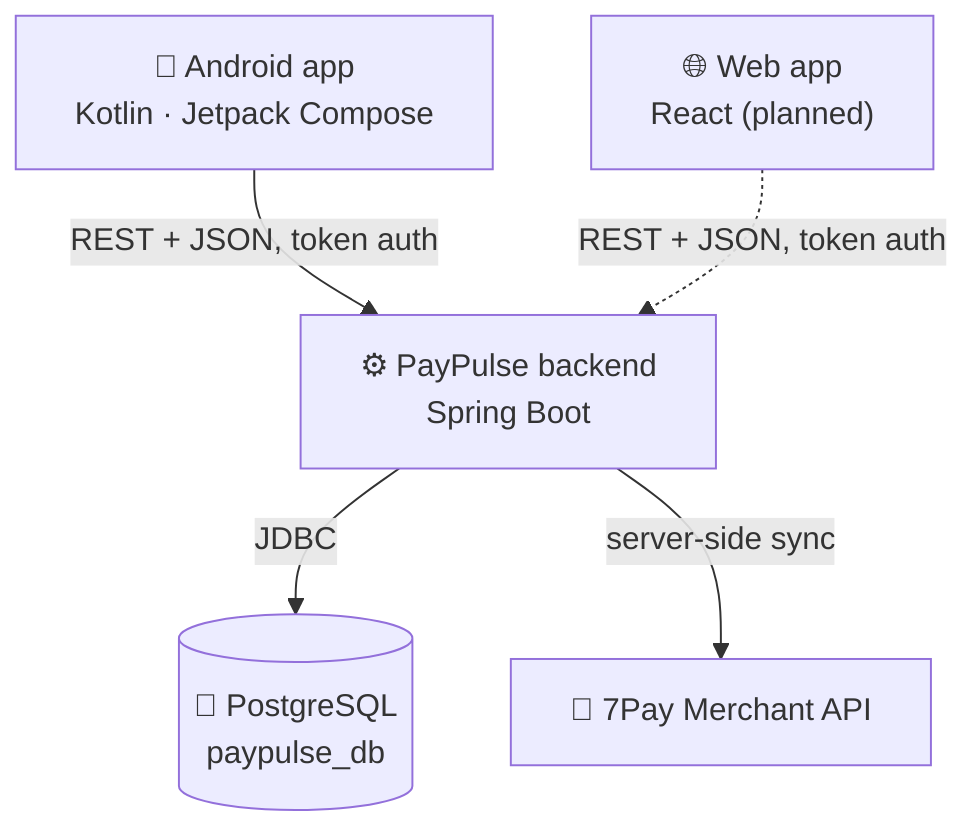
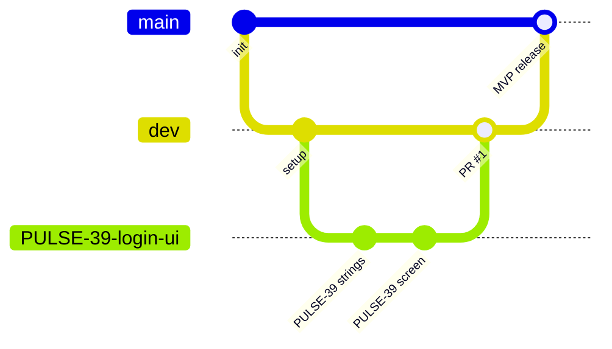

<div align="center">

# 💳 PayPulse

### 7Pay Merchant Portal: a self-service app for merchants

Manage your team, explore your sale points and POS terminals, and keep track of every card transaction, all in one place.


**FOI Varaždin** · *Analiza i razvoj programa (AIR)* · Work-based learning with **7 PAYMENTS d.o.o.**

[About](#-about) · [Features](#-features) · [Architecture](#%EF%B8%8F-architecture) · [Getting started](#-getting-started) · [Workflow](#-development-workflow) · [Team](#-team)

</div>

---

## 📖 About

**PayPulse** is a merchant portal for business clients (*trgovci*) of **7Pay**, a Croatian card payment provider. Merchants use it to:

- manage who in their company can access the portal,
- see their structure: **merchant → sale points → POS terminals**,
- browse and filter their **card transactions**,
- follow turnover on a **dashboard** and download **reports**.

The project is built by team **"sreckovici"** using Scrum. Planning lives in **Jira** (project key `PULSE`) and documentation in **Confluence**.

> **Current focus:** the 📱 **Android app**. A web client (React) is planned later.

---

## ✨ Features

| Area | What it does | Status |
|---|---|---|
| 🔐 **Authentication** | Log in with e-mail and password, set your own password on first login, reset a forgotten password | 🚧 Sprint 1 |
| 👥 **User management** | Admins create, edit, activate, deactivate and delete users. Roles: **Admin** (read/write) and **User** (read-only) | 🚧 Sprint 1 |
| 📊 **Dashboard** | Interactive turnover charts by card brand (Visa, Mastercard, Maestro…) and by acquirer | 📋 Planned |
| 🏬 **Merchant hierarchy** | Merchants, sale points (outlets) and terminals with search, filters and details | 📋 Planned |
| 💸 **Transactions** | Transaction list with advanced filters (date, status, type, card brand, auth code, RRN) and details | 📋 Planned |
| 📄 **Reports** | Daily, weekly and monthly reports with CSV download | 📋 Planned |

> There is **no public sign-up**. An Admin creates each account, and the new user sets their own password through an activation e-mail.

---

## 🏗️ Architecture



**Ground rules**

- 📱 Clients talk **only to our backend**, never to 7Pay directly.
- 🔑 The 7Pay API key lives **only in backend configuration** (environment variables), never in the app or this repo.
- 🗄️ The backend keeps a **local copy** of merchants, outlets, terminals and transactions. 7Pay keeps only the last 12 months, so our database is the long-term store.
- 💳 Card numbers are **only ever stored and shown masked** (e.g. `479852****1409`).

---

## 🧰 Tech stack

| Part | Technology |
|---|---|
| 📱 **Android** | Kotlin, Jetpack Compose, Material 3, MVVM · minSdk 26, targetSdk 37 |
| ⚙️ **Backend** | Java 21, Spring Boot 4 (Web MVC, Data JPA, Security), Gradle |
| 🐘 **Database** | PostgreSQL (schema in `backend/src/main/resources/db/db.sql`) |
| 🛠️ **Tools** | Android Studio, IntelliJ IDEA, pgAdmin, Git + GitHub, Jira, Confluence |

---

## 📁 Repository structure

```text
PayPulse-selfservice-portal/
├── android/                     📱 Android app (open THIS folder in Android Studio)
│   └── app/src/main/java/com/example/paypulse/
│       ├── data/                repositories (fake data now, real API later)
│       ├── domain/              business rules, e.g. password policy
│       ├── navigation/          one NavHost for the whole app
│       └── ui/
│           ├── theme/           7Pay colors, typography, shapes
│           ├── components/      shared buttons, text fields…
│           └── auth/            login/, setpassword/, forgotpassword/
│
├── backend/                     ⚙️ Spring Boot API (open THIS folder in IntelliJ IDEA)
│   └── src/main/
│       ├── java/com/example/paypulse/
│       │   ├── config/          security, dev database reset
│       │   ├── controller/      REST endpoints under /api/...
│       │   ├── dto/             request/response records
│       │   ├── mapper/          entity ↔ DTO
│       │   ├── model/           JPA entities
│       │   ├── repository/      Spring Data repositories
│       │   └── service/         business logic (interface + impl)
│       └── resources/db/db.sql  🗄️ database schema (source of truth)
│
└── README.md
```

> `android/` and `backend/` are **separate Gradle projects**. Open each one on its own, not the repository root.

---

## 🚀 Getting started

### 1. Prerequisites

| Tool | Version | Note |
|---|---|---|
| ☕ JDK | **21** (Eclipse Temurin) | Exactly 21. The backend toolchain will not run on 25. |
| 🤖 Android Studio | latest stable | Install SDK **API 37** in SDK Manager |
| 🐘 PostgreSQL + pgAdmin | 17 or newer | Default port `5432`, user `postgres` |
| 🧠 IntelliJ IDEA | latest | For the backend (free with a student licence) |
| 🌿 Git | latest | Set `user.email` to the e-mail on your GitHub account |

### 2. Clone

Clone into a short path **without spaces, č/ć/š, or OneDrive** (e.g. `C:\dev`):

```bash
git clone https://github.com/lpolak22/PayPulse-selfservice-portal.git
cd PayPulse-selfservice-portal
git switch dev
```

### 3. Database

1. In **pgAdmin**, right-click your server → **Create → Database** → name it `paypulse_db`.
2. Store your PostgreSQL password in an **environment variable** (never in a file in this repo):

   **Windows (PowerShell):**
   ```powershell
   [Environment]::SetEnvironmentVariable("SPRING_DATASOURCE_PASSWORD", 'your-password', "User")
   ```
   **macOS / Linux:**
   ```bash
   export SPRING_DATASOURCE_PASSWORD='your-password'   # add to ~/.zshrc or ~/.bashrc
   ```
3. Restart your terminal and IDEs so they see the new variable.

### 4. Backend

From the `backend/` folder:

```bash
./gradlew refreshDb     # ⚠️ DROPS and recreates the local schema from db/db.sql
./gradlew bootRun       # starts the API on http://localhost:8080
```

On Windows use `.\gradlew.bat` instead of `./gradlew`.

✅ **Check:** open <http://localhost:8080/api/users>. You should get `[]` or a list of users.

### 5. Android app

1. Android Studio → **Open** → select the `android/` folder.
2. Wait for **Gradle sync** to finish.
3. Pick an emulator and press ▶ **Run**.

> 💡 From the Android **emulator**, your computer's backend is at **`http://10.0.2.2:8080`**, not `localhost`.

---

## 🔄 Development workflow

### Branches



| Branch | Purpose |
|---|---|
| `main` | Stable, presentable version. Updated only at milestones (e.g. MVP presentation). |
| `dev` | Integration branch. All finished work is merged here through Pull Requests. |
| `PULSE-<N>-short-name` | One branch per Jira task, created from an up-to-date `dev`. |

🚫 Never commit directly to `main`.

### Commits

Every commit starts with the **Jira key**, so Jira links it automatically to the task:

```text
PULSE-<N> [AREA] Short description in imperative mood
```

| Tag | Area |
|---|---|
| `[AND]` | Android |
| `[BE]` | Backend |
| `[WEB]` | Web |
| `[DB]` | Database |
| `[DOC]` | Documentation |

**Example:** `PULSE-39 [AND] Add login screen layout`

### Pull Requests

1. Push your branch and open a PR **into `dev`**. Start the title with the Jira key.
2. At least **one teammate** reviews and approves it.
3. Keep PRs small: one task or subtask each.

### ✅ Definition of Done (short version)

- [ ] All Acceptance Criteria of the task are met
- [ ] Branch named after the task key, merged into `dev` through an approved PR
- [ ] Unit tests for new logic, all tests pass
- [ ] Builds with no new warnings
- [ ] No method longer than 30 lines
- [ ] UI matches the sketch attached to the Acceptance Criteria
- [ ] Jira task moved to **Done**

The full Definition of Done is in Confluence.

---

## 🔒 Security and confidentiality

This repository is **public**. Never commit:

- 🔑 passwords, API keys, tokens or other secrets,
- 📄 the 7Pay API specification (it is under NDA),
- ⚙️ `local.properties`, `application-local.properties`, `.idea/` or build output.

Secrets go into **environment variables** or git-ignored local files.

---

## 🧯 Troubleshooting

| Problem | Fix |
|---|---|
| `password authentication failed for user "postgres"` | Check `SPRING_DATASOURCE_PASSWORD`, restart the IDE, then run `./gradlew --stop` and try again. |
| Gradle complains about the Java version | Set **Gradle JVM** and **Project SDK** to JDK 21 in the IDE settings. |
| The app can't reach the backend from the emulator | Use `http://10.0.2.2:8080`, not `localhost`. |
| Android Studio shows no `app` run configuration | You opened the repository root. Open the `android/` folder instead. |

---

## 👥 Team

**Team "sreckovici"**: Ana Bilić · Marija Bilić · Ennio David Komljenović · Jan Pobi · Lucija Polak (team lead)

**Company mentors (7Pay):** Kristijan Matanović · Goran Matanović

---

<div align="center">

Made at **FOI Varaždin** · 2026

</div>
